# distributed-x-infrastructure-platform-engineering-modules

[](LICENSE)
[](https://support.huaweicloud.com/intl/en-us/)
[](#)
> Huawei Cloud platform engineering module library: a set of Terraform modules that can be combined directly, covering the environment layer, service layer, and component layer.
---

## 1. Overview

This practice provides a Huawei Cloud Terraform module library consisting of 17 modules, covering the environment layer (VPC / CCE clusters), the service layer (APIG + FunctionGraph / ELB + CCE Deployment / scheduled tasks / async consumers), and the component layer (OBS buckets). It is intended for cloud-native development / DevOps / platform engineering engineers and can be used as a reference architecture / learning sample / production template.

### Core Capabilities

- **Environment layer modules**: VPC + subnets, CCE clusters (node form / serverless form), single-VPC function sample
- **Service layer modules**: APIG + FunctionGraph, ELB + CCE workloads, FunctionGraph scheduled tasks, DMS Kafka async consumers
- **Component layer modules**: OBS bucket (minimal reusable unit)
- **For Huawei Cloud users**: each module can be deployed independently or referenced directly by higher-level configurations

---

## 2. Table of Contents

- [1. Overview](#1-overview)
- [2. Table of Contents](#2-table-of-contents)
- [3. Architecture Diagram](#3-architecture-diagram)
- [4. Highlights](#4-highlights)
- [5. Cloud Services Used](#5-cloud-services-used)
- [6. Prerequisites](#6-prerequisites)
- [7. Quick Start](#7-quick-start)
- [8. Step-by-Step Deployment](#8-step-by-step-deployment)
- [9. Usage / Verification](#9-usage--verification)
- [10. Cleanup](#10-cleanup)
- [11. Detailed Explanation](#11-detailed-explanation)
- [12. Dependencies](#12-dependencies)
- [13. FAQ / Troubleshooting](#13-faq--troubleshooting)
- [14. Contributing](#14-contributing)
- [15. License](#15-license)
- [16. Contact / Maintainers](#16-contact--maintainers)

---

## 3. Architecture Diagram

> Modular layered architecture: environment layer → service layer → component layer, with each module independently reusable.

```mermaid
flowchart TB
    subgraph Env[Environment Layer]
        V[vpc-env]
        FE[cce-cluster-env]
        E2E[cce-node-pool-env]
        LV[functiongraph-vpc]
    end
    subgraph Svc[Service Layer]
        API[apig-functiongraph-svc]
        AR[cae-webapp-svc]
        BES[backend-node-svc]
        BFS[backend-serverless-svc]
        LBES[elb-backend-node-svc]
        LBFS[elb-backend-serverless-svc]
        SES[scheduled-node-svc]
        SFS[scheduled-serverless-svc]
        SLS[scheduled-function-svc]
        WES[worker-node-svc]
        WFS[worker-serverless-svc]
        WLS[worker-function-svc]
    end
    subgraph Comp[Component Layer]
        OBS[obs-bucket-component]
    end
    V --> FE
    V --> E2E
    V --> API
    V --> LBES
    V --> LBFS
    V --> WES
    V --> WFS
    V --> WLS
    OBS -. referenced .-> API
    OBS -. referenced .-> LBES
    OBS -. referenced .-> LBFS
```



**Key Components**:

- **Environment layer**: the dependency base for all service layer modules; choose vpc-env / cce-node-pool-env / cce-cluster-env by scenario
- **Service layer**: by deployment form, containers (`*-serverless-svc` / `*-node-svc`) and functions (apig-functiongraph-svc / scheduled-function-svc / worker-function-svc); by scheduling mode, immediate (backend / load-balanced), scheduled (scheduled), and async (worker)
- **Component layer**: the minimal reusable unit, referenced by service layer modules

---

## 4. Highlights

- **Modular layering**: environment / service / component layers with clear dependency relationships for on-demand composition
- **Independently deployable**: every module is a standard Terraform module and requires no external orchestration service
- **Hybrid workloads**: CCE containers + FunctionGraph functions + DMS Kafka queues, so you can choose the most suitable form for each business scenario
- **Observable / scalable**: every service module supports HPA auto-scaling; K8s workloads are deployed with kubectl, following cloud-native ecosystem conventions
- **Complete coverage of typical scenarios**: HTTP API / async tasks / scheduled tasks / microservice backends / static assets

---

## 5. Cloud Services Used

| Service | Purpose | Notes |
|---|---|---|
| VPC | Network foundation | public/private subnets, route tables |
| CCE | Container clusters | node form + serverless node pools |
| FunctionGraph | Function compute | timer / HTTP / Kafka / DMS triggers |
| APIG | API gateway | dedicated edition connecting to FunctionGraph backends |
| ELB | Load balancing | dedicated application / network flavors |
| OBS | Object storage | buckets / server-side encryption |
| SWR | Container images | image repository + organization |
| DMS Kafka | Message queue | preferred for high-throughput scenarios; DMS RabbitMQ can be used for light loads |
| SMN | Message notification | topics + subscriptions |
| LTS | Log service | centralized log streams |
| KMS | Key management | server-side encryption keys |
| IAM | Identity and access | Agency + policies |

> All services can be created with one click through the Terraform configuration in this repository; for cleanup, see [Section 10 "Cleanup"](#10-cleanup).

---

## 6. Prerequisites

| Item | Requirement | Notes |
|---|---|---|
| Huawei Cloud account | cn-north-4 enabled | Obtain the Access Key on the Huawei Cloud "My Credentials" page and fill it into the deployment script |
| Terraform | >= 1.5 | local installation or Terraform Cloud |
| huaweicloud Provider | ~> 1.70 | downloaded automatically by `terraform init` |
| kubectl | >= 1.27 | for deploying K8s workloads (Deployment / Service / HPA / CronJob) |
| OBS bucket | create it yourself + upload the zip | for FunctionGraph function code packages |

---

## 7. Quick Start

Deploy a minimal viable combination (VPC + CCE cluster):

```hcl
# demo.tf
terraform {
  required_version = ">= 1.5"
  required_providers {
    huaweicloud = {
      source  = "huaweicloud/huaweicloud"
      version = "~> 1.70"
    }
  }
}

provider "huaweicloud" {
  region = "cn-north-4"
}

module "vpc" {
  source = "./infra/modules/vpc-env"

  project_name = "demo"
  region       = "cn-north-4"
}

module "cce" {
  source = "./infra/modules/cce-cluster-env"

  project_name = "demo"
  region       = "cn-north-4"
  vpc_id       = module.vpc.vpc_id
  subnet_id    = module.vpc.private_subnet_one_id
}

output "vpc_id"    { value = module.vpc.vpc_id }
output "cluster_id" { value = module.cce.cluster_id }
```

```bash
export HW_ACCESS_KEY="<your-access-key>"
export HW_SECRET_KEY="<your-secret-key>"
terraform init
terraform apply -auto-approve
```

---

## 8. Step-by-Step Deployment

See [`docs/deployment-guide.md`](docs/deployment-guide.md). Summary:

1. Deploy `vpc-env` (network foundation)
2. Deploy `cce-cluster-env` or `cce-node-pool-env` (CCE cluster)
3. Deploy service layer modules (`elb-backend-*` / `apig-functiongraph-svc` / `worker-*` / `scheduled-*`)
4. Deploy K8s workloads with kubectl (refer to each module's `deployment_yaml_hint` output)

---

## 9. Usage / Verification

> **Verification note**: the commands listed in this section have been cross-checked against the actual `output` definitions of each module. After deployment, follow these steps to verify on your own and confirm that the business functionality works before treating the delivery as complete.

### 9.1 Verify VPC

```bash
terraform output vpc_id
# Huawei Cloud console → VPC → demo-vpc should be "Available"
```

### 9.2 Verify CCE Cluster

```bash
terraform output cluster_id
# Console → CCE → Cluster → demo-cce should be "Running"
```

### 9.3 Verify FunctionGraph Function

```bash
# Console → FunctionGraph → Function List → find demo-*-function
# Click the "Test" button; it should return 200
```

### 9.4 Verify APIG

```bash
terraform output module.api.apig_invoke_url
# curl https://<api_invoke_url> should return 200
# (the full invocation URL is assembled by the module; the exact path segments are per the APIG console → API detail → "Invocation URL")
```

### 9.5 Verify ELB

```bash
terraform output module.lb_svc.elb_ip
# Accessing http://<elb_ip> should return 200 (provided the K8s workload has been deployed)
```

### 9.6 Verify DMS Kafka Consumer

> The DMS Kafka trigger is created automatically by the `huaweicloud_fgs_function_trigger` resource on `apply` (topic = `${project_name}-processing`, consumer group = `${project_name}-consumer`); no manual configuration in the console is needed. The prerequisite is that the function has VPC access enabled and the security group allows inbound traffic on port 9092.

```bash
# Write a message to the topic with a Kafka client
# Check the function execution logs in the FunctionGraph console (LTS); consumer records should be visible
```

After deployment, follow these steps to verify that the business functionality works before considering the delivery complete.

---

## 10. Cleanup

```bash
# Destroy in reverse dependency order
terraform destroy
```

Confirm that all resources have been deleted (check in the console).

---

## 11. Detailed Explanation

### 11.1 Module Dependency Graph

| Module | Depends on |
|---|---|
| `vpc-env` | None (base) |
| `cce-node-pool-env` / `cce-cluster-env` | `vpc-env` (vpc_id + subnet_id) |
| `apig-functiongraph-svc` | `vpc-env` (vpc_id + subnet_id + sg_id) |
| `cae-webapp-svc` | `cce-node-pool-env` or `cce-cluster-env` (cluster_id) |
| `backend-*-svc` | `cce-node-pool-env` or `cce-cluster-env` (cluster_id) |
| `elb-backend-*-svc` | `vpc-env` (vpc_id + subnets) + `cce-node-pool-env` or `cce-cluster-env` (cluster_id) |
| `scheduled-node-svc` | `cce-node-pool-env` (cluster_id) |
| `scheduled-serverless-svc` | None (uses the FunctionGraph TIMER directly) |
| `scheduled-function-svc` | `vpc-env` (vpc_id + subnets + sg_id) |
| `worker-*-svc` | `vpc-env` (vpc_id + subnet_id + sg_id) + `cce-node-pool-env` or `cce-cluster-env` (optional) |
| `functiongraph-vpc` | None (brings its own VPC) |
| `obs-bucket-component` | None (independent component) |

### 11.2 Workload Deployment

The `deployment_yaml_hint` output of each `*-svc` module provides a K8s YAML template; the business side deploys it with `kubectl apply -f -`. See `docs/deployment-guide.md` §5.2.

---

## 12. Dependencies

| Dependency | Version |
|---|---|
| Terraform | >= 1.5 |
| huaweicloud Provider | ~> 1.70 |
| kubectl | >= 1.27 |
| Huawei Cloud account | cn-north-4 enabled |

---

## 13. FAQ / Troubleshooting

| Issue | Resolution |
|---|---|
| `Error: VPC quota exceeded` | Submit a ticket to raise the VPC quota |
| `Error: ELB flavor not available in zone` | Adjust the availability_zone list or change the flavor |
| CCE cluster creation timeout | Check security group rules; CCE requires ports 22 / 5443 open by default |
| FunctionGraph code upload fails | Check OBS bucket permissions and the bucket policy |
| DMS Kafka trigger does not fire | Check whether the FunctionGraph agency has DMS permissions |
| K8s Pod fails to start | Use `kubectl describe pod` to check events; common causes: image pull failure / insufficient resources / configuration error |

---

## 14. Contributing

Issues and PRs are welcome. Before submitting:

1. Read `docs/architecture.md` and `docs/deployment-guide.md` to understand module layering and dependencies
2. New modules follow the existing naming (`{category}-{variant}-svc` or `{category}-env`)
3. Terraform field names follow the official Huawei Cloud documentation
4. A module README contains three sections: "Purpose / Usage / Resource Composition"

---

## 15. License

This repository is licensed under MIT No Attribution, Copyright Huawei Cloud. See the [LICENSE](LICENSE) file.

---

## 16. Contact / Maintainers
| Item | Content |
|---|---|
| **Creator** | [dgc-git](https://github.com/dgc-git) |
| **Maintainer** | [dgc-git](https://github.com/dgc-git) |
| **Contact** | GitHub Issues / PR (see [Section 14](#14-contributing)) |
