# distributed-x-infrastructure-platform-engineering-modules

[](LICENSE)
[](https://support.huaweicloud.com/intl/en-us/)
[](#)
> 华为云平台工程模块库：一组可直接组合使用的 Terraform 模块，覆盖环境层、服务层、组件层。
---

## 1. 简介 / Overview

本实践提供一组由 17 个模块构成的华为云 Terraform 模块库，覆盖环境层（VPC / CCE 集群）、服务层（API 网关 + 函数 / ELB + CCE Deployment / 定时任务 / 异步消费者）和组件层（OBS 桶）。面向云原生开发 / DevOps / 平台工程 工程师，可作为参考架构 / 学习样例 / 生产模板 使用。

### 核心能力

- **环境层模块**：VPC + 子网、CCE 集群（节点形态 / 无服务器形态）、单 VPC 函数示例
- **服务层模块**：APIG + FunctionGraph、ELB + CCE 工作负载、FunctionGraph 定时任务、DMS Kafka 异步消费者
- **组件层模块**：OBS 桶（最小可复用单元）
- **面向华为云用户**：每个模块可独立部署，也可被上层配置直接引用

---

---

## 2. 目录

- [1. 简介 / Overview](#1-简介--overview)
- [2. 目录](#2-目录)
- [3. 架构图](#3-架构图)
- [4. 方案亮点](#4-方案亮点)
- [5. 涉及云服务](#5-涉及云服务)
- [6. 前置条件](#6-前置条件)
- [7. 快速开始](#7-快速开始)
- [8. 分步部署](#8-分步部署)
- [9. 使用方法 / 验证](#9-使用方法--验证)
- [10. 清理资源](#10-清理资源)
- [11. 详细说明](#11-详细说明)
- [12. 依赖](#12-依赖)
- [13. FAQ / 故障排除](#13-faq--故障排除)
- [14. 贡献指南](#14-贡献指南)
- [15. 许可证](#15-许可证)
- [16. 联系方式 / 维护者](#16-联系方式--维护者)

---

---

## 3. 架构图

> 模块化分层架构：环境层 → 服务层 → 组件层，每个模块独立可复用。

```mermaid
flowchart TB
    subgraph Env[环境层]
        V[vpc-env]
        FE[cce-cluster-env]
        E2E[cce-node-pool-env]
        LV[functiongraph-vpc]
    end
    subgraph Svc[服务层]
        API[apig-functiongraph-svc]
        AR[cae-webapp-svc]
        BES[backend-node-svc]
        BFS[backend-serverless-svc]
        LBES[elb-backend-node-svc]
        LBFS[elb-backend-serverless-svc]
        SES[scheduled-node-svc]
        SFS[scheduled-serverless-svc]
        SLS[scheduled-function-svc]
        WES[worker-node-svc]
        WFS[worker-serverless-svc]
        WLS[worker-function-svc]
    end
    subgraph Comp[组件层]
        OBS[obs-bucket-component]
    end
    V --> FE
    V --> E2E
    V --> API
    V --> LBES
    V --> LBFS
    V --> WES
    V --> WFS
    V --> WLS
    OBS -.被引用.-> API
    OBS -.被引用.-> LBES
    OBS -.被引用.-> LBFS
```



**关键组件说明**：

- **环境层**：所有服务层模块的依赖基础；按场景选 vpc-env / cce-node-pool-env / cce-cluster-env
- **服务层**：按部署形态分容器（`*-serverless-svc` / `*-node-svc`）和函数（apig-functiongraph-svc / scheduled-function-svc / worker-function-svc）；按调度方式分立即（backend / load-balanced）/ 定时（scheduled）/ 异步（worker）
- **组件层**：最小可复用单元，被服务层引用

---

---

## 4. 方案亮点

- **模块化分层**：环境 / 服务 / 组件三层，依赖关系清晰，便于按需组合
- **独立可部署**：每个模块都是标准 Terraform 模块，无需任何外部编排服务
- **混合工作负载**：CCE 容器 + FunctionGraph 函数 + DMS Kafka 队列，按业务场景选择最合适形态
- **可观测 / 可扩展**：每个服务模块支持 HPA 自动扩缩；K8s 工作负载由 kubectl 部署，符合云原生生态惯例
- **完整覆盖典型场景**：HTTP API / 异步任务 / 定时任务 / 微服务后端 / 静态资源

---

---

## 5. 涉及云服务

| 服务 | 用途 | 备注 |
|---|---|---|
| VPC | 网络底座 | 公私网子网、路由表 |
| CCE | 容器集群 | 节点形态 + 无服务器形态节点池 |
| FunctionGraph | 函数计算 | 定时触发 / HTTP 触发 / Kafka 触发 / DMS 触发 |
| APIG | API 网关 | 专享版对接 FunctionGraph 后端 |
| ELB | 负载均衡 | 独享型 application / network |
| OBS | 对象存储 | 桶 / 服务端加密 |
| SWR | 容器镜像 | 镜像仓库 + 组织 |
| DMS Kafka | 消息队列 | 高吞吐场景首选；轻量场景可改用 DMS RabbitMQ |
| SMN | 消息通知 | 主题 + 订阅 |
| LTS | 日志服务 | 集中日志流 |
| KMS | 密钥管理 | 服务端加密密钥 |
| IAM | 身份与权限 | 委托（Agency）+ 策略 |

> 所有服务均可通过本仓库的 Terraform 一键创建；如需清理，请参见 [第 10 节「清理资源」](#10-清理资源)。

---

---

## 6. 前置条件

| 项 | 要求 | 说明 |
|---|---|---|
| 华为云账号 | 已开通 cn-north-4 | 在华为云「我的凭证」页面获取 Access Key 并填入部署脚本 |
| Terraform | >= 1.5 | 本地安装或 Terraform Cloud |
| huaweicloud Provider | ~> 1.70 | 通过 `terraform init` 自动下载 |
| kubectl | >= 1.27 | 部署 K8s 工作负载（Deployment / Service / HPA / CronJob） |
| OBS 桶 | 自建 + 上传 zip | 用于 FunctionGraph 函数代码包 |

---

---

## 7. 快速开始

部署一个最小可用组合（VPC + CCE 集群）：

```hcl
# demo.tf
terraform {
  required_version = ">= 1.5"
  required_providers {
    huaweicloud = {
      source  = "huaweicloud/huaweicloud"
      version = "~> 1.70"
    }
  }
}

provider "huaweicloud" {
  region = "cn-north-4"
}

module "vpc" {
  source = "./infra/modules/vpc-env"

  project_name = "demo"
  region       = "cn-north-4"
}

module "cce" {
  source = "./infra/modules/cce-cluster-env"

  project_name = "demo"
  region       = "cn-north-4"
  vpc_id       = module.vpc.vpc_id
  subnet_id    = module.vpc.private_subnet_one_id
}

output "vpc_id"    { value = module.vpc.vpc_id }
output "cluster_id" { value = module.cce.cluster_id }
```

```bash
export HW_ACCESS_KEY="<your-access-key>"
export HW_SECRET_KEY="<your-secret-key>"
terraform init
terraform apply -auto-approve
```

---

---

## 8. 分步部署

详见 [`docs/deployment-guide.md`](docs/deployment-guide.md)。摘要：

1. 部署 `vpc-env`（网络底座）
2. 部署 `cce-cluster-env` 或 `cce-node-pool-env`（CCE 集群）
3. 部署服务层模块（`elb-backend-*` / `apig-functiongraph-svc` / `worker-*` / `scheduled-*`）
4. 用 kubectl 部署 K8s 工作负载（参考各模块的 `deployment_yaml_hint` 输出）

---

---

## 9. 使用方法 / 验证

> **验证说明**：本节所列命令与各模块的真实 `output` 定义逐一核对一致。请在部署完成后按本节步骤自行验证，确认业务功能可用后再视为交付完成。

### 9.1 验证 VPC

```bash
terraform output vpc_id
# 华为云控制台 → VPC → demo-vpc 应为「可用」状态
```

### 9.2 验证 CCE 集群

```bash
terraform output cluster_id
# 控制台 → CCE → 集群 → demo-cce 应为「运行中」
```

### 9.3 验证 FunctionGraph 函数

```bash
# 控制台 → FunctionGraph → 函数列表 → 找到 demo-*-function
# 点击「测试」按钮，应返回 200
```

### 9.4 验证 APIG

```bash
terraform output module.api.apig_invoke_url
# curl https://<api_invoke_url> 应返回 200
# （完整调用地址由模块拼装；确切路径段以控制台 APIG → API 详情「调用地址」为准）
```

### 9.5 验证 ELB

```bash
terraform output module.lb_svc.elb_ip
# 访问 http://<elb_ip> 应返回 200（前提是 K8s 工作负载已部署）
```

### 9.6 验证 DMS Kafka 消费者

> DMS Kafka 触发器已由 `huaweicloud_fgs_function_trigger` 资源在 `apply` 时自动创建（topic = `${project_name}-processing`、消费组 = `${project_name}-consumer`），无需在控制台手工配置。前提是函数已开启 VPC 访问且安全组放行 9092 入站。

```bash
# 用 Kafka 客户端往 topic 写一条消息
# 在 FunctionGraph 控制台查看函数执行日志（LTS），应看到消费记录
```

部署完成后请按本节步骤自行验证，确认业务功能可用，方可视为交付完成。

---

---

## 10. 清理资源

```bash
# 按依赖顺序反向销毁
terraform destroy
```

确认所有资源已被删除（控制台核查）。


---

---

## 11. 详细说明

### 11.1 模块依赖关系

| 模块 | 依赖 |
|---|---|
| `vpc-env` | 无（基础） |
| `cce-node-pool-env` / `cce-cluster-env` | `vpc-env`（vpc_id + subnet_id） |
| `apig-functiongraph-svc` | `vpc-env`（vpc_id + subnet_id + sg_id） |
| `cae-webapp-svc` | `cce-node-pool-env` 或 `cce-cluster-env`（cluster_id） |
| `backend-*-svc` | `cce-node-pool-env` 或 `cce-cluster-env`（cluster_id） |
| `elb-backend-*-svc` | `vpc-env`（vpc_id + subnets） + `cce-node-pool-env` 或 `cce-cluster-env`（cluster_id） |
| `scheduled-node-svc` | `cce-node-pool-env`（cluster_id） |
| `scheduled-serverless-svc` | 无（直接用 FunctionGraph TIMER） |
| `scheduled-function-svc` | `vpc-env`（vpc_id + subnets + sg_id） |
| `worker-*-svc` | `vpc-env`（vpc_id + subnet_id + sg_id） + `cce-node-pool-env` 或 `cce-cluster-env`（可选） |
| `functiongraph-vpc` | 无（自带 VPC） |
| `obs-bucket-component` | 无（独立组件） |

### 11.2 工作负载部署

每个 `*-svc` 模块的 `deployment_yaml_hint` 输出 K8s YAML 模板，业务方用 `kubectl apply -f -` 部署。详见 `docs/deployment-guide.md` §5.2。

---

---

## 12. 依赖

| 依赖 | 版本 |
|---|---|
| Terraform | >= 1.5 |
| huaweicloud Provider | ~> 1.70 |
| kubectl | >= 1.27 |
| 华为云账号 | 已开通 cn-north-4 |

---

---

## 13. FAQ / 故障排除

| 问题 | 解决 |
|---|---|
| `Error: VPC quota exceeded` | 提交工单提升 VPC 配额 |
| `Error: ELB flavor not available in zone` | 调整 availability_zone 列表或更换 flavor |
| CCE 集群创建超时 | 检查安全组规则；CCE 默认需要 22 / 5443 端口放行 |
| FunctionGraph 上传代码失败 | 检查 OBS 桶权限 + 桶策略 |
| DMS Kafka 触发器不触发 | 检查 FunctionGraph 委托是否含 DMS 权限 |
| K8s Pod 启动失败 | 用 `kubectl describe pod` 查看事件；常见原因：镜像拉取失败 / 资源不足 / 配置错误 |

---

---

## 14. 贡献指南

欢迎提交 Issue / PR。提交前请：

1. 阅读 `docs/architecture.md` 与 `docs/deployment-guide.md`，了解模块分层与依赖关系
2. 新模块遵循现有命名（`{category}-{variant}-svc` 或 `{category}-env`）
3. Terraform 字段命名遵循华为云官方文档
4. 模块 README 含「用途 / 使用方式 / 资源构成」三段

---

---

## 15. 许可证

本仓库采用 MIT No Attribution 许可证，Copyright Huawei Cloud。详见 [LICENSE](LICENSE) 文件。

---

---

## 16. 联系方式 / 维护者
| 项 | 内容 |
|---|---|
| **创建者** | [dgc-git](https://github.com/dgc-git) |
| **维护者** | [dgc-git](https://github.com/dgc-git) |
| **联系方式** | GitHub Issues / PR（见[第 14 节](#14-贡献指南)） |
